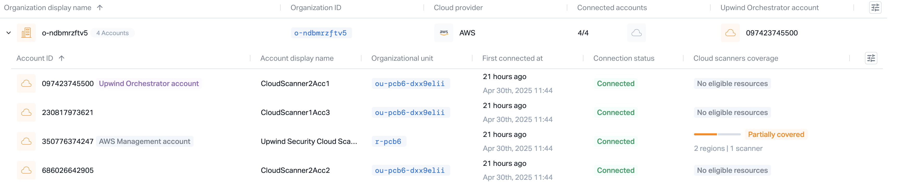

<!-- BEGIN_TF_DOCS -->

# Upwind AWS Organization Onboarding Terraform module
This module defines the IAM roles, policies and resources necessary to onboard the accounts of an AWS Organization
into to Upwind. Rather than attempting to deploy the resources into multiple accounts, the module has been defined
such that it can be readily integrated into IaC tools such as Terragrunt, which are much more capable of deploying 
the resources at scale across multiple accounts.
The structure of the terraform in this module is as follows:
* top level conditional logic which creates the resources based on account type.
* sub modules - one for each resource. These should be reasonably self contained units which could be run separately
  if desired.
## Organization Onboarding Process
The goal of the onboarding process is to connect all the necessary accounts within your AWS organization into Upwind, allowing 
Upwind to perform security audits and scans on those accounts as necessary.
The process can be initiated through the Upwind console which guides the user through the process, before applying 
this module to the accounts to create the necessary IAM roles and polices etc.
Once onboarded, it will be possible to inspect the accounts from inside the Upwind console.

## Account Types
Notionally the onboarding process takes 3 account types into consideration.
* Management account: An account with delegated permissions which should be used to manage the remaining accounts within the
  Organization. In the context of the Upwind onboarding process, this account is used
  to discover additional details about the AWS organization - eg the accounts.
* Orchestrator Account: The orchestrator account is regarded as a special account and is the account in which
  Upwind will orchestrate its scanning activities - creating the CloudScanner resources as necessary.
  Additional orchestrator accounts (`additional_orchestrator_account_ids`) can be added alongside the default one
  (`orchestrator_account_id`, which is then required); each gets the orchestrator resources.
* Other accounts: The remaining accounts should be connected as these are accounts which are assumed to need protection
  whether through auditing or scanning.
## Roles and IAM Policies
The module defines a number of IAM roles and policies, some of which can be assumed from the upwind SaaS for the use cases 
described below.
### Trusted Entity
Any role that can be assumed from Upwind includes a trusted entity similar to the following example.
``` json
{
    "Version": "2012-10-17",
    "Statement": [
        {
            "Effect": "Allow",
            "Principal": {
                "AWS": "arn:aws:iam::340457201789:root"
            },
            "Action": "sts:AssumeRole",
            "Condition": {
                "StringEquals": {
                    "sts:ExternalId": "<<external-id>>"
                }
            }
        }
    ]
}
```
The external-id will be provided by Upwind as part of the onboarding processes. The trusted account is Upwind's
account for the AWS partition the module is applied in (the commercial one is shown); `upwind_trusted_account_id`
overrides it.
### Organization Discovery role
The Organization discovery role is a read only role which can be assumed and is used to discover the accounts within
the AWS organization. It is assumed by Upwind to discover the accounts and account structure within the AWS organization.
The definition for the role can be found in the [iam_org_discovery_role](https://github.com/upwindsecurity/terraform-aws-onboarding/tree/main/modules/iam_org_discovery_role) submodule, and its creation is conditional so that the role is only created in the
management account.
> [!TIP]
> The Organization Discovery role only needs to be created in the management account.
### Account Service role
The Account Service role, for the most part, is a role that is assumed from Upwind to grant read only and audit access to the account, and which can be created
in all accounts. In the orchestrator account, if one is selected, the role contains elevated permissions which allow it to be used
for the installation of CloudScanners.
This role is defined in the [iam_account_service_role](https://github.com/upwindsecurity/terraform-aws-onboarding/tree/main/modules/iam_account_service_role) submodule.
> [!TIP]
> This Account Service role should be created in all accounts which are to be audited or scanned - which may optionally include the management account. If configuring 
> an orchestrator account the Account Service role must be created in the account with the elevated permissions.
> [!IMPORTANT]
> If `upwind_agentless_k8s_account_whitelist` is set and either
> `upwind_agentless_k8s_access_entries_enabled` or `upwind_agentless_k8s_ssm_enabled`
> is enabled, you must also set `current_account_id`. Terraform must know the account ID
> during plan so it can determine whether to create the agentless Kubernetes IAM policies.
### CloudScanner Administrator role
This role is only created in the orchestrator account - if one has been defined. It is the role granted to the
CloudScanner resources (Lambdas, ASG and EC2 instances) allowing them to function.
Note: Removing this role while it has attached resources (eg CloudScanners) should be avoided, as it is connected to these resources.
The definition for the role can be found in the [iam_cloudscanner_admin_role](https://github.com/upwindsecurity/terraform-aws-onboarding/tree/main/modules/iam_cloudscanner_admin_role) submodule.
> [!TIP]
> The CloudScanner admin role must be created in the orchestrator account if one has been selected.
### CloudScanner Execution role
This role grants the necessary permissions to allows the CloudScanner to perform cross account scans from the orchestrator account. Specifically,
the role can be assumed by the CloudScanner in the orchestrator account and can be used to create resources such as disk snapshots and fetch lambdas from accounts other 
than the orchestrator account.
The role is defined in the [iam_cloudscanner_execution_role](https://github.com/upwindsecurity/terraform-aws-onboarding/tree/main/modules/iam_cloudscanner_execution_role) submodule.
> [!TIP]
> The CloudScanner Execution role should be installed in all accounts which are to be scanned.

### CloudScanner Customer Assume role (SaaS mode)
When the module is run in SaaS mode (`is_saas = true`), the CloudScanner admin role and the credentials secret are not created in the default
orchestrator account (`orchestrator_account_id`). Instead a customer assume role is created there, which the Upwind SaaS account
(`cloudscanner_saas_trusted_account_id`) can assume to perform scanning operations. Additional orchestrator accounts still get the
CloudScanner admin role and credentials secret.
The role is defined in the [iam_cloudscanner_saas_customer_assume_role](https://github.com/upwindsecurity/terraform-aws-onboarding/tree/main/modules/iam_cloudscanner_saas_customer_assume_role) submodule.

### Organization Discovery Role Registration
Once the Organization Discovery role has been created in the management account, its ARN (available via the `organization_discovery_role_arn` output) must be registered with Upwind.
This is normally done by entering the ARN into the Upwind console as part of the guided onboarding process, which in turn initiates the account discovery within the Upwind backend systems.
The Upwind backend will continue to connect accounts as they are onboarded, discovering resources, and if an orchestrator account has been configured, will install CloudScanners as scannable targets
(eg VMs, lambdas etc.) are discovered.

> [!TIP]
> If you are unable to complete the registration through the Upwind console, the Discovery role ARN can be provided to Upwind technical support who can enter it into the system manually.
## CloudScanners
Shortly after the onboarding has completed, CloudScanners will be automatically installed into the orchestrator account, 
one per region which has scannable resources within all of the accounts.
Each CloudScanner includes a number of resources, including AWS Lambdas and Auto Scaling groups, which are used to scale
a number of VMs (workers) to perform the scans.
## Integration Guidelines
By default the module should contain all of the necessary logic such that it can be integrated into your IaC tool and apply
to all of the accounts within your AWS org. It should be possible to include the same variables/parameters into for each account, and doing this would be the preferred
method. However the module has been organized so that if required the resources can be separated out and more readily integrated into you IAC.
When doing so following guidelines should be followed.
### Resource Naming and Tags
By default the module provides default names for each of the resources - even allowing for small random suffix
to be appended to the end of each name. 
These names can be changed to align with your own naming conventions. However it is important that the same name for a given role function is used consistently
across all accounts and that the role names are set as defined in the submodules. The tags are used to help discover the role names and other resources created during on boarding.
When renaming a role - the name must be consistent in all accounts.
### Authentication Secrets
By default the module can either accept the secret clientId and secret value - or a secret ARN containing the generated 
values. If creating an ARN the values should be stored within the secret as follows:
```json
{
  "clientId": "<<client-id>>",
  "clientSecret": "<<client-secret>>"
}
```
You will need to ensure that the ARN is accessible across all regions, and if using non-default KMS keys to protect
the secret, that these are readily accessible - tailoring the roles if necessary.
### Custom Tags
Custom tags can be added to the module, and these will be applied to every resource created by the module - IAM roles and policies, and secrets.
## Examples
The following example of the module which can be applied to all accounts to create the roles as described above. This example defines the variable
install_roles_in_management_account which means the module will install the Account Service and CloudScanner Execution roles in the management account.
```hcl
provider "aws" {
  region = "us-east-1"
}

module "upwind_aws_org_onboarding" {
  source = "upwindsecurity/onboarding/aws"
  # Get versions from https://registry.terraform.io/modules/upwindsecurity/onboarding/aws/latest
  # The root-module source exists from 4.0.0 onwards; earlier versions used
  # the //modules/aws-org-onboarding (3.x) or //modules/main/aws-org-onboarding
  # (2.x) submodule paths.
  version = "~> 5.0"

  external_id                         = "F083B753-06B5-40B2-BE41-4035D6A7B6C7"
  management_account_id               = "098765432109"
  install_roles_in_management_account = true
  role_name_suffix                    = "otmgax1m"

  # optional. for cloudscanner installation only
  orchestrator_account_id               = "123456789012"
  upwind_cloudscanner_auth_client_id    = "<<cloudscanner-client-id>>"
  upwind_cloudscanner_auth_secret_value = "<<cloudscanner-client-secret>>"
}

# Output the ARN of the organization discovery role. This ARN should be
# entered into the Upwind console to complete the onboarding process.
output "discovery_arn" {
  value = module.upwind_aws_org_onboarding.organization_discovery_role_arn
}
```

The following example is comparable to the first, but shows how to inject the alternative role names into the module. This would be the preferred method for changing roles
as should ensure continuity across all accounts, although it is recommended to choose more appropriate values that those in this example. The example also illustrates on
custom tags can be applied to the module:
```hcl
provider "aws" {
  region = "us-east-1"
}

module "upwind_aws_org_onboarding" {
  source = "upwindsecurity/onboarding/aws"
  # Get versions from https://registry.terraform.io/modules/upwindsecurity/onboarding/aws/latest
  # The root-module source exists from 4.0.0 onwards; earlier versions used
  # the //modules/aws-org-onboarding (3.x) or //modules/main/aws-org-onboarding
  # (2.x) submodule paths.
  version = "~> 5.0"

  external_id = "F083B753-06B5-40B2-BE41-4035D6A7B6C7"

  orchestrator_account_id             = "123456789012"
  management_account_id               = "098765432109"
  install_roles_in_management_account = true

  role_name_suffix = "otmgax1m"

  upwind_cloudscanner_auth_client_id    = "<<cloudscanner-client-id>>"
  upwind_cloudscanner_auth_secret_value = "<<cloudscanner-client-secret>>"

  organization_role_name                = "Alt-role-name-1"
  account_service_role_name             = "Alt-role-name-2"
  cloudscanner_administration_role_name = "Alt-role-name-3"
  cloudscanner_execution_role_name      = "Alt-role-name-4"

  // Define some custom tags to be applied to the resources created by the module.
  custom_tags = {
    TagKey1 = "TagValue1",
    TagKey2 = "TagValue2"
  }
}

# Output the ARN of the organization discovery role. This ARN should be
# entered into the Upwind console to complete the onboarding process.
output "discovery_arn" {
  value = module.upwind_aws_org_onboarding.organization_discovery_role_arn
}
```

The following example shows how to enable agentless Kubernetes permissions for only a subset
of accounts. When using `upwind_agentless_k8s_account_whitelist`, you must also provide
`current_account_id` so Terraform can evaluate resource creation during plan.

```hcl
provider "aws" {
  region = "us-east-1"
}

module "upwind_aws_org_onboarding" {
  source = "upwindsecurity/onboarding/aws"
  # Get versions from https://registry.terraform.io/modules/upwindsecurity/onboarding/aws/latest
  # The root-module source exists from 4.0.0 onwards; earlier versions used
  # the //modules/aws-org-onboarding (3.x) or //modules/main/aws-org-onboarding
  # (2.x) submodule paths.
  version = "~> 5.0"

  external_id = "F083B753-06B5-40B2-BE41-4035D6A7B6C7"

  orchestrator_account_id             = "123456789012"
  management_account_id               = "098765432109"
  install_roles_in_management_account = true

  role_name_suffix = "otmgax1m"

  upwind_cloudscanner_auth_client_id    = "<<cloudscanner-client-id>>"
  upwind_cloudscanner_auth_secret_value = "<<cloudscanner-client-secret>>"

  current_account_id                          = "222222222222"
  upwind_agentless_k8s_access_entries_enabled = true
  upwind_agentless_k8s_ssm_enabled            = true
  upwind_agentless_k8s_account_whitelist = [
    "111111111111",
    "222222222222",
  ]
}

# Output the ARN of the organization discovery role. This ARN should be
# entered into the Upwind console to complete the onboarding process.
output "discovery_arn" {
  value = module.upwind_aws_org_onboarding.organization_discovery_role_arn
}
```

## Providers

| Name | Version |
|------|---------|
| <a name="provider_aws"></a> [aws](#provider\_aws) | >= 6.0.0 |
| <a name="provider_null"></a> [null](#provider\_null) | ~> 3.0 |
## Outputs

| Name | Description |
|------|-------------|
| <a name="output_account_service_role_arn"></a> [account\_service\_role\_arn](#output\_account\_service\_role\_arn) | The ARN of the IAM role created for security auditing purposes. |
| <a name="output_account_service_role_name"></a> [account\_service\_role\_name](#output\_account\_service\_role\_name) | The Name of the IAM role created for security auditing purposes. |
| <a name="output_cloudscanner_admin_role_arn"></a> [cloudscanner\_admin\_role\_arn](#output\_cloudscanner\_admin\_role\_arn) | The ARN of the CloudScanner admin IAM role created for managing cloud scanning operations. |
| <a name="output_cloudscanner_admin_role_name"></a> [cloudscanner\_admin\_role\_name](#output\_cloudscanner\_admin\_role\_name) | The Name of the CloudScanner admin IAM role created for managing cloud scanning operations. |
| <a name="output_cloudscanner_execution_role_arn"></a> [cloudscanner\_execution\_role\_arn](#output\_cloudscanner\_execution\_role\_arn) | The ARN of the CloudScanner execution IAM role created for performing cloud scanning operations. |
| <a name="output_cloudscanner_execution_role_name"></a> [cloudscanner\_execution\_role\_name](#output\_cloudscanner\_execution\_role\_name) | The Name of the CloudScanner execution IAM role created for performing cloud scanning operations. |
| <a name="output_cloudscanner_saas_customer_assume_role_arn"></a> [cloudscanner\_saas\_customer\_assume\_role\_arn](#output\_cloudscanner\_saas\_customer\_assume\_role\_arn) | The ARN of the CloudScanner SaaS customer assume role. Only set when is\_saas = true and applied to the orchestrator account. |
| <a name="output_cloudscanner_saas_customer_assume_role_name"></a> [cloudscanner\_saas\_customer\_assume\_role\_name](#output\_cloudscanner\_saas\_customer\_assume\_role\_name) | The name of the CloudScanner SaaS customer assume role. Only set when is\_saas = true and applied to the orchestrator account. |
| <a name="output_cloudscanner_secret_arn"></a> [cloudscanner\_secret\_arn](#output\_cloudscanner\_secret\_arn) | The ARN of the CloudScanner Credentials secret. |
| <a name="output_cloudscanner_secret_name"></a> [cloudscanner\_secret\_name](#output\_cloudscanner\_secret\_name) | The name of the CloudScanner Credentials secret. |
| <a name="output_cloudscanner_settings_parameter_name"></a> [cloudscanner\_settings\_parameter\_name](#output\_cloudscanner\_settings\_parameter\_name) | The name of the SSM parameter holding the Upwind onboarding settings. Only set in the orchestrator accounts. |
| <a name="output_organization_discovery_role_arn"></a> [organization\_discovery\_role\_arn](#output\_organization\_discovery\_role\_arn) | The ARN of the IAM role created for account discovery purposes. This ARN should be entered in to the Upwind Console |
| <a name="output_organization_discovery_role_name"></a> [organization\_discovery\_role\_name](#output\_organization\_discovery\_role\_name) | The Name of the IAM role created for account discovery purposes. |
| <a name="output_upwind_release_version"></a> [upwind\_release\_version](#output\_upwind\_release\_version) | The release version tag assigned to the deployment. For version visibility. |
## Inputs

| Name | Description | Type | Default | Required |
|------|-------------|------|---------|:--------:|
| <a name="input_account_service_agentless_k8s_access_entries_policy_name"></a> [account\_service\_agentless\_k8s\_access\_entries\_policy\_name](#input\_account\_service\_agentless\_k8s\_access\_entries\_policy\_name) | The base name to be used when creating the Agentless Kubernetes Access Entries Policy for the Account Service role. | `string` | `"UpwindAccountServiceAgentlessK8sAEPolicy"` | no |
| <a name="input_account_service_agentless_k8s_ssm_policy_name"></a> [account\_service\_agentless\_k8s\_ssm\_policy\_name](#input\_account\_service\_agentless\_k8s\_ssm\_policy\_name) | The base name to be used when creating the Agentless Kubernetes SSM Policy for the Account Service role. | `string` | `"UpwindAccountServiceAgentlessK8sSSMPolicy"` | no |
| <a name="input_account_service_cloudformation_policy_name"></a> [account\_service\_cloudformation\_policy\_name](#input\_account\_service\_cloudformation\_policy\_name) | The base name to be used when creating the CloudFormation Policy for the Account Service role. | `string` | `"UpwindAccountServiceCloudFormationPolicy"` | no |
| <a name="input_account_service_cloudscanner_ec2_network_policy_name"></a> [account\_service\_cloudscanner\_ec2\_network\_policy\_name](#input\_account\_service\_cloudscanner\_ec2\_network\_policy\_name) | The base name to be used when creating the CloudScanner EC2 Network Policy for the Account Service role. This policy contains permissions to create and manage EC2 network resources which can be omitted if you intend to provide the network stack configuration. | `string` | `"UpwindAccountServiceCloudScannerEC2NetworkPolicy"` | no |
| <a name="input_account_service_cloudscanner_ec2_policy_name"></a> [account\_service\_cloudscanner\_ec2\_policy\_name](#input\_account\_service\_cloudscanner\_ec2\_policy\_name) | The base name to be used when creating the CloudScanner EC2 Access Policy for the Account Service role. | `string` | `"UpwindAccountServiceCloudScannerEC2Policy"` | no |
| <a name="input_account_service_cloudscanner_policy_name"></a> [account\_service\_cloudscanner\_policy\_name](#input\_account\_service\_cloudscanner\_policy\_name) | The base name to be used when creating the CloudScanner Access Policy for the Account Service role. | `string` | `"UpwindAccountServiceCloudScannerPolicy"` | no |
| <a name="input_account_service_role_name"></a> [account\_service\_role\_name](#input\_account\_service\_role\_name) | The name to be given to the Account Service IAM role. The Account Service role is created in each account to be connected and is generally used for account auditing purposes. | `string` | `"UpwindAccountServiceRole"` | no |
| <a name="input_account_service_role_permissions_boundary"></a> [account\_service\_role\_permissions\_boundary](#input\_account\_service\_role\_permissions\_boundary) | Optional. A pre-existing IAM permissions boundary policy to attach to the Account Service (read-only) role, in every account where the role is created (the management account and each onboarded account). This constrains the maximum permissions the role can have and does not grant any permissions itself - the boundary policy must already exist in each of those accounts. You may provide either the full policy ARN (e.g. `arn:aws:iam::123456789012:policy/MyBoundary`) or just the policy name including any path but WITHOUT a leading slash (e.g. `MyBoundary` or `team/security/MyBoundary`), in which case the ARN is formed per-account as `arn:<partition>:iam::<that-account-id>:policy/<value>`. Because a bare ARN is account-specific, prefer the name/path form for org-wide deployments so each account resolves its own local policy. Leave unset to create the role without a permissions boundary. | `string` | `null` | no |
| <a name="input_additional_orchestrator_account_ids"></a> [additional\_orchestrator\_account\_ids](#input\_additional\_orchestrator\_account\_ids) | A list of 12-digit account IDs to treat as additional Upwind orchestrator accounts, alongside the default orchestrator account. The CloudScanners are installed and managed in each orchestrator account. The orchestrator resources are deployed to these accounts, the CloudScanner Execution role in every account trusts their CloudScanner Administration role, and the list is recorded in the onboarding settings and in a tag on the Organization (discovery) role so that Upwind can find them. Leave empty to use only the default orchestrator account. | `list(string)` | `[]` | no |
| <a name="input_cloudscanner_administration_role_name"></a> [cloudscanner\_administration\_role\_name](#input\_cloudscanner\_administration\_role\_name) | The name to be given to the CloudScanner Administration IAM role. This role will only be created in the Orchestrator account if configured, and grants the operational permissions for the CloudScanners to run. | `string` | `"UpwindCloudScannerAdministrationRole"` | no |
| <a name="input_cloudscanner_administration_role_permissions_boundary"></a> [cloudscanner\_administration\_role\_permissions\_boundary](#input\_cloudscanner\_administration\_role\_permissions\_boundary) | Optional. A pre-existing IAM permissions boundary policy to attach to the CloudScanner Administration role, which is created only in the orchestrator account. This constrains the maximum permissions the role can have and does not grant any permissions itself - the boundary policy must already exist in that account. You may provide either the full policy ARN (e.g. `arn:aws:iam::123456789012:policy/MyBoundary`) or just the policy name including any path but WITHOUT a leading slash (e.g. `MyBoundary` or `team/security/MyBoundary`), in which case the ARN is formed as `arn:<partition>:iam::<account-id>:policy/<value>`. Leave unset to create the role without a permissions boundary. | `string` | `null` | no |
| <a name="input_cloudscanner_administration_role_profile_name"></a> [cloudscanner\_administration\_role\_profile\_name](#input\_cloudscanner\_administration\_role\_profile\_name) | The name of the EC2 Instance profile that will be associated with the CloudScanner Admin role. | `string` | `"UpwindCloudScannerAdministrationRoleProfile"` | no |
| <a name="input_cloudscanner_dspm_rds_execution_policy_name"></a> [cloudscanner\_dspm\_rds\_execution\_policy\_name](#input\_cloudscanner\_dspm\_rds\_execution\_policy\_name) | The base name to be used when creating the CloudScanner DSPM RDS Policy attached to the CloudScanner Execution role. Must differ from the DSPM RDS Policy name. | `string` | `"UpwindCloudScannerDspmRdsExecutionPolicy"` | no |
| <a name="input_cloudscanner_dspm_rds_policy_name"></a> [cloudscanner\_dspm\_rds\_policy\_name](#input\_cloudscanner\_dspm\_rds\_policy\_name) | The base name of the DSPM RDS managed policy attached to the CloudScanner admin role. Must differ from cloudscanner\_dspm\_rds\_execution\_policy\_name. | `string` | `"UpwindCloudScannerDspmRdsPolicy"` | no |
| <a name="input_cloudscanner_execution_role_name"></a> [cloudscanner\_execution\_role\_name](#input\_cloudscanner\_execution\_role\_name) | The name to be given to the CloudScanner Execution IAM role. This role will be created in each account onboarded, and grants permissions to allow the CloudScanners to perform cross-account scanning. | `string` | `"UpwindCloudScannerExecutionRole"` | no |
| <a name="input_cloudscanner_execution_role_permissions_boundary"></a> [cloudscanner\_execution\_role\_permissions\_boundary](#input\_cloudscanner\_execution\_role\_permissions\_boundary) | Optional. A pre-existing IAM permissions boundary policy to attach to the CloudScanner Execution role, in every account where the role is created (the management account and each onboarded account). This constrains the maximum permissions the role can have and does not grant any permissions itself - the boundary policy must already exist in each of those accounts. You may provide either the full policy ARN (e.g. `arn:aws:iam::123456789012:policy/MyBoundary`) or just the policy name including any path but WITHOUT a leading slash (e.g. `MyBoundary` or `team/security/MyBoundary`), in which case the ARN is formed per-account as `arn:<partition>:iam::<that-account-id>:policy/<value>`. Because a bare ARN is account-specific, prefer the name/path form for org-wide deployments so each account resolves its own local policy. Leave unset to create the role without a permissions boundary. | `string` | `null` | no |
| <a name="input_cloudscanner_saas_customer_assume_role_name"></a> [cloudscanner\_saas\_customer\_assume\_role\_name](#input\_cloudscanner\_saas\_customer\_assume\_role\_name) | The name of the CloudScanner Customer Assume IAM role to be created, used by the Upwind SaaS to assume roles in the Customer orchestrator account. | `string` | `"UpwindCloudScannerCustomerAssumeRole"` | no |
| <a name="input_cloudscanner_saas_customer_assume_role_permissions_boundary"></a> [cloudscanner\_saas\_customer\_assume\_role\_permissions\_boundary](#input\_cloudscanner\_saas\_customer\_assume\_role\_permissions\_boundary) | Optional. A pre-existing IAM permissions boundary policy to attach to the CloudScanner SaaS Customer Assume role, which is created only in the orchestrator account for SaaS deployments. This constrains the maximum permissions the role can have and does not grant any permissions itself - the boundary policy must already exist in that account. You may provide either the full policy ARN (e.g. `arn:aws:iam::123456789012:policy/MyBoundary`) or just the policy name including any path but WITHOUT a leading slash (e.g. `MyBoundary` or `team/security/MyBoundary`), in which case the ARN is formed as `arn:<partition>:iam::<account-id>:policy/<value>`. Leave unset to create the role without a permissions boundary. | `string` | `null` | no |
| <a name="input_cloudscanner_saas_trusted_account_id"></a> [cloudscanner\_saas\_trusted\_account\_id](#input\_cloudscanner\_saas\_trusted\_account\_id) | The account ID that will be configured as the trust principal for the Customer Assume role when deploying with CloudScanner SaaS. | `string` | `null` | no |
| <a name="input_cloudscanner_secret_name"></a> [cloudscanner\_secret\_name](#input\_cloudscanner\_secret\_name) | The base name used when creating the CloudScanner credentials secret. | `string` | `"/cloudscanner-credentials"` | no |
| <a name="input_credentials_secret_name_prefix"></a> [credentials\_secret\_name\_prefix](#input\_credentials\_secret\_name\_prefix) | The prefix for the AWS Secrets Manager secret name storing Upwind client credentials. Used to create the secret if the client ID and client secret are provided. | `string` | `"/upwind"` | no |
| <a name="input_current_account_id"></a> [current\_account\_id](#input\_current\_account\_id) | (Optional). Explicit account ID for AWS account being configured. Provide this when using upwind\_agentless\_k8s\_account\_whitelist so terraform can determine resource creation during plan | `string` | `null` | no |
| <a name="input_custom_tags"></a> [custom\_tags](#input\_custom\_tags) | Custom tags which shall be applied to each resource created by the module. | `map(string)` | `{}` | no |
| <a name="input_deployment_region"></a> [deployment\_region](#input\_deployment\_region) | Upwind SaaS Region | `string` | `"us"` | no |
| <a name="input_enable_securityhub_integration"></a> [enable\_securityhub\_integration](#input\_enable\_securityhub\_integration) | Allow the Account Service role to publish Upwind findings into this account's AWS Security Hub (securityhub:BatchImportFindings). | `bool` | `false` | no |
| <a name="input_external_id"></a> [external\_id](#input\_external\_id) | The external ID for secure cross-account role assumption. This is included in the trusted identity of each role that can be assumed from the Upwind SaaS. | `string` | n/a | yes |
| <a name="input_iam_role_path"></a> [iam\_role\_path](#input\_iam\_role\_path) | The common IAM Role Path to be used with all IAM role and policies. This maps straight through to the IAM Path property on the IAM roles and policies - i.e. it must begin and end with a forward slash `/` - eg `/security/upwind/`. | `string` | `"/"` | no |
| <a name="input_install_roles_in_management_account"></a> [install\_roles\_in\_management\_account](#input\_install\_roles\_in\_management\_account) | Controls whether roles, in addition to the Org Discovery role, are created in the management account. If disabled, Upwind is unable to perform audits or scans in the Org Management account. | `bool` | `false` | no |
| <a name="input_is_saas"></a> [is\_saas](#input\_is\_saas) | Enable CloudScanner SaaS mode, where Upwind runs the CloudScanners. The default orchestrator account then gets the CloudScanner SaaS Customer Assume role, which the Upwind SaaS assumes, instead of the CloudScanner Administration role and credentials secret; additional orchestrator accounts still get the Administration role and secret. | `bool` | `false` | no |
| <a name="input_is_virtual_organization"></a> [is\_virtual\_organization](#input\_is\_virtual\_organization) | Deploy the Account Service role in Virtual Organization mode, for accounts onboarded together without an AWS Organization. There is then no Org Discovery role, so the Account Service role carries the tags Upwind would otherwise read from it. | `bool` | `false` | no |
| <a name="input_management_account_id"></a> [management\_account\_id](#input\_management\_account\_id) | The account ID of the AWS Organization management account. The Org Discovery role will be created in this account. | `string` | n/a | yes |
| <a name="input_orchestrator_account_id"></a> [orchestrator\_account\_id](#input\_orchestrator\_account\_id) | The account ID of the default Upwind orchestrator account. The orchestrator account is considered a "special" account where the CloudScanners will be installed and managed. If specified, additional roles and permissions will be created in this account to allow for the installation and management of the CloudScanners. | `string` | `null` | no |
| <a name="input_organization_role_name"></a> [organization\_role\_name](#input\_organization\_role\_name) | The name to be given to the Org Discovery IAM role. The Org Discovery role is created in the management account and grants permissions to discover the Organization account structure. | `string` | `"UpwindOrganizationServiceRole"` | no |
| <a name="input_organization_role_permissions_boundary"></a> [organization\_role\_permissions\_boundary](#input\_organization\_role\_permissions\_boundary) | Optional. A pre-existing IAM permissions boundary policy to attach to the Organization (discovery) role, which is created in the management account. This constrains the maximum permissions the role can have and does not grant any permissions itself - the boundary policy must already exist in that account and must allow the AWS Organizations and CloudFormation permissions the role needs. You may provide either the full policy ARN (e.g. `arn:aws:iam::123456789012:policy/MyBoundary`) or just the policy name including any path but WITHOUT a leading slash (e.g. `MyBoundary` or `team/security/MyBoundary`), in which case the ARN is formed as `arn:<partition>:iam::<this-account-id>:policy/<value>`. Leave unset to create the role without a permissions boundary. | `string` | `null` | no |
| <a name="input_outpost_only_account_ids"></a> [outpost\_only\_account\_ids](#input\_outpost\_only\_account\_ids) | A list of 12-digit account IDs that must not be scanned using CloudScanner SaaS, because they use an Outpost (customer-hosted) CloudScanner deployment. Only relevant when CloudScanner SaaS is enabled: in these accounts the CloudScanner SaaS Customer Assume role is explicitly denied from assuming the CloudScanner Execution role. The list is also recorded in the onboarding settings. It applies to individual accounts only, not to OUs. Leave empty if no accounts are Outpost-only. | `list(string)` | `[]` | no |
| <a name="input_role_name_suffix"></a> [role\_name\_suffix](#input\_role\_name\_suffix) | A suffix that will be appended to the role names to ensure they are unique. | `string` | `null` | no |
| <a name="input_single_account_onboarding_role_permissions_boundary"></a> [single\_account\_onboarding\_role\_permissions\_boundary](#input\_single\_account\_onboarding\_role\_permissions\_boundary) | (Optional). Permissions boundary policy (ARN or policy name/path) to attach to the single account onboarding Lambda execution role. | `string` | `null` | no |
| <a name="input_ssm_parameter_prefix"></a> [ssm\_parameter\_prefix](#input\_ssm\_parameter\_prefix) | The SSM Parameter Store path prefix under which the onboarding settings are stored in the orchestrator accounts. This should not normally be changed. | `string` | `"/upwind/onboarding/configuration"` | no |
| <a name="input_upwind_agentless_k8s_access_entries_enabled"></a> [upwind\_agentless\_k8s\_access\_entries\_enabled](#input\_upwind\_agentless\_k8s\_access\_entries\_enabled) | Enable the creation of the policy for agentless Kubernetes resource fetching using EKS access entries as the authentication method. | `bool` | `false` | no |
| <a name="input_upwind_agentless_k8s_account_whitelist"></a> [upwind\_agentless\_k8s\_account\_whitelist](#input\_upwind\_agentless\_k8s\_account\_whitelist) | (Optional). If set, this will limit the accounts in which the agentless Kubernetes access entry and SSM permissions are created. | `list(string)` | `[]` | no |
| <a name="input_upwind_agentless_k8s_eks_admin_view_policy_enabled"></a> [upwind\_agentless\_k8s\_eks\_admin\_view\_policy\_enabled](#input\_upwind\_agentless\_k8s\_eks\_admin\_view\_policy\_enabled) | Allow the role to associate AmazonEKSAdminViewPolicy (in addition to AmazonEKSViewPolicy) on Upwind-created EKS access entries. Only takes effect when agentless Kubernetes resource fetching using access entries is turned on. | `bool` | `true` | no |
| <a name="input_upwind_agentless_k8s_ssm_enabled"></a> [upwind\_agentless\_k8s\_ssm\_enabled](#input\_upwind\_agentless\_k8s\_ssm\_enabled) | Enable the creation of the policy for agentless Kubernetes resource fetching from private EKS clusters via SSM tunnels. | `bool` | `false` | no |
| <a name="input_upwind_cfn_bucket"></a> [upwind\_cfn\_bucket](#input\_upwind\_cfn\_bucket) | Optional. The Upwind S3 bucket hosting the CloudFormation templates the account service role policies allow. Defaults to Upwind's bucket for the AWS partition being deployed to. | `string` | `null` | no |
| <a name="input_upwind_cloud_organization_id"></a> [upwind\_cloud\_organization\_id](#input\_upwind\_cloud\_organization\_id) | The Cloud Organization ID generated by Upwind (not an AWS organization ID). Required when is\_virtual\_organization = true. | `string` | `null` | no |
| <a name="input_upwind_cloudscanner_auth_client_id"></a> [upwind\_cloudscanner\_auth\_client\_id](#input\_upwind\_cloudscanner\_auth\_client\_id) | The CloudScanner client ID for Upwind Security authentication. | `string` | `null` | no |
| <a name="input_upwind_cloudscanner_auth_secret_arn"></a> [upwind\_cloudscanner\_auth\_secret\_arn](#input\_upwind\_cloudscanner\_auth\_secret\_arn) | An ARN for an existing CloudScanner secret can be specified as an alternative to the client ID and client secret on Outpost deployments. If provided, it will be used instead of creating a secret. This needs to be accessible to the CloudScanners which shall be installed in the orchestrator account. For SaaS deployments, this field should remain empty. | `string` | `null` | no |
| <a name="input_upwind_cloudscanner_auth_secret_value"></a> [upwind\_cloudscanner\_auth\_secret\_value](#input\_upwind\_cloudscanner\_auth\_secret\_value) | The CloudScanner client secret for Upwind Security authentication. | `string` | `null` | no |
| <a name="input_upwind_cloudscanner_management_enabled"></a> [upwind\_cloudscanner\_management\_enabled](#input\_upwind\_cloudscanner\_management\_enabled) | Enable the permissions necessary to support automated CloudScanner deployment and management. If disabled the CloudScanner stacks will need to be installed manually. | `bool` | `true` | no |
| <a name="input_upwind_enable_self_managed_kms_key"></a> [upwind\_enable\_self\_managed\_kms\_key](#input\_upwind\_enable\_self\_managed\_kms\_key) | Specify whether to use your own KMS customer managed key (CMK) or an Upwind managed KMS key. | `bool` | `false` | no |
| <a name="input_upwind_feature_dspm_account_whitelist"></a> [upwind\_feature\_dspm\_account\_whitelist](#input\_upwind\_feature\_dspm\_account\_whitelist) | (Optional). If set, and given upwind\_feature\_dspm\_enabled is true, this will limit the accounts that we create the DSPM S3 permissions in | `list(string)` | `[]` | no |
| <a name="input_upwind_feature_dspm_enabled"></a> [upwind\_feature\_dspm\_enabled](#input\_upwind\_feature\_dspm\_enabled) | Enable the creation of roles to enable DSPM scanning. This includes permissions to access the contents of S3 buckets. | `bool` | `true` | no |
| <a name="input_upwind_feature_dspm_rds_account_allowlist"></a> [upwind\_feature\_dspm\_rds\_account\_allowlist](#input\_upwind\_feature\_dspm\_rds\_account\_allowlist) | (Optional). If set, and given upwind\_feature\_dspm\_rds\_enabled is true, this limits the accounts that we create the DSPM RDS permissions in. | `list(string)` | `[]` | no |
| <a name="input_upwind_feature_dspm_rds_enabled"></a> [upwind\_feature\_dspm\_rds\_enabled](#input\_upwind\_feature\_dspm\_rds\_enabled) | Enable DSPM scanning of RDS databases. This includes the permissions required to snapshot and restore RDS databases so their contents can be scanned. | `bool` | `false` | no |
| <a name="input_upwind_include_ec2_network_management_permissions"></a> [upwind\_include\_ec2\_network\_management\_permissions](#input\_upwind\_include\_ec2\_network\_management\_permissions) | Include the permissions necessary to create and manage EC2 network resources. If providing custom networking configuration from the start, this can be omitted. Note: CloudScanners will not be installed until the necessary network configuration has been provided. | `bool` | `true` | no |
| <a name="input_upwind_serverless_bucket_prefix"></a> [upwind\_serverless\_bucket\_prefix](#input\_upwind\_serverless\_bucket\_prefix) | Bucket that stores the single account onboarding lambda only used for upwind managed orgs | `string` | `"upwind-serverless-functions"` | no |
| <a name="input_upwind_single_account_onboarding_lambda_enabled"></a> [upwind\_single\_account\_onboarding\_lambda\_enabled](#input\_upwind\_single\_account\_onboarding\_lambda\_enabled) | Whether to create the single account onboarding Lambda (and its supporting IAM role, secret and log group). Only applies when is\_virtual\_organization = true. | `bool` | `true` | no |
| <a name="input_upwind_trusted_account_id"></a> [upwind\_trusted\_account\_id](#input\_upwind\_trusted\_account\_id) | The account id to be configured as the trusted principal: the account Upwind will assume the roles from. Defaults to Upwind's account for the AWS partition being deployed to. | `string` | `null` | no |
## Resources

| Name | Type |
|------|------|
| [aws_iam_policy.cloudscanner_dspm_rds](https://registry.terraform.io/providers/hashicorp/aws/latest/docs/resources/iam_policy) | resource |
| [aws_iam_policy.cloudscanner_dspm_rds_execution](https://registry.terraform.io/providers/hashicorp/aws/latest/docs/resources/iam_policy) | resource |
| [aws_iam_role_policy_attachment.cloudscanner_admin_role_dspm_rds](https://registry.terraform.io/providers/hashicorp/aws/latest/docs/resources/iam_role_policy_attachment) | resource |
| [aws_iam_role_policy_attachment.cloudscanner_execution_role_dspm_rds](https://registry.terraform.io/providers/hashicorp/aws/latest/docs/resources/iam_role_policy_attachment) | resource |
| [aws_ssm_parameter.cloudscanner_settings](https://registry.terraform.io/providers/hashicorp/aws/latest/docs/resources/ssm_parameter) | resource |
| [null_resource.validate_cloudscanner_auth](https://registry.terraform.io/providers/hashicorp/null/latest/docs/resources/resource) | resource |
| [null_resource.validate_management_account](https://registry.terraform.io/providers/hashicorp/null/latest/docs/resources/resource) | resource |
| [null_resource.validate_orchestrator_accounts](https://registry.terraform.io/providers/hashicorp/null/latest/docs/resources/resource) | resource |
| [null_resource.validate_saas_config](https://registry.terraform.io/providers/hashicorp/null/latest/docs/resources/resource) | resource |
| [null_resource.validate_virtual_organization](https://registry.terraform.io/providers/hashicorp/null/latest/docs/resources/resource) | resource |
| [aws_caller_identity.current](https://registry.terraform.io/providers/hashicorp/aws/latest/docs/data-sources/caller_identity) | data source |
| [aws_partition.current](https://registry.terraform.io/providers/hashicorp/aws/latest/docs/data-sources/partition) | data source |
<!-- END_TF_DOCS -->

## Upgrade notes
These notes cover upgrading from 4.x to 5.0.

### AWS provider 6
The module now requires the AWS provider `>= 6.0` (previously `>= 5.32`): it reads the region from the `region`
attribute of the `aws_region` data source, which replaces the deprecated `name`. If your configuration pins the AWS
provider to 5.x, upgrade it (see the provider's
[version 6 upgrade guide](https://registry.terraform.io/providers/hashicorp/aws/latest/docs/guides/version-6-upgrade))
before upgrading this module.

### Onboarding settings, additional orchestrator accounts and DSPM RDS
This release brings the module in line with the Upwind CloudFormation (v3) onboarding templates.

New inputs (all optional; the defaults keep a single orchestrator account):
* `additional_orchestrator_account_ids`: further orchestrator accounts alongside `orchestrator_account_id`, which
  remains required. The CloudScanner admin role, credentials secret and onboarding settings are also created in these
  accounts, and the CloudScanner Execution role in every account trusts their CloudScanner admin role. In SaaS mode
  the default orchestrator account gets the onboarding settings and the customer assume role but no CloudScanner
  admin role or credentials secret; the additional orchestrator accounts get all three.
* `outpost_only_account_ids`: in SaaS mode, accounts the Upwind SaaS CloudScanners must not scan (the customer assume
  role is denied the CloudScanner Execution role there).
* `ssm_parameter_prefix`: the SSM Parameter Store path of the onboarding settings (default
  `/upwind/onboarding/configuration`, plus `/<role_name_suffix>` when a suffix is set).
* `cloudscanner_dspm_rds_execution_policy_name`: the base name of the new DSPM RDS policy for the CloudScanner
  Execution role (default `UpwindCloudScannerDspmRdsExecutionPolicy`).
* `cloudscanner_dspm_rds_policy_name`: the base name of the DSPM RDS policy for the CloudScanner admin role (default
  `UpwindCloudScannerDspmRdsPolicy`, the name used so far). Must differ from
  `cloudscanner_dspm_rds_execution_policy_name`.
* `cloudscanner_saas_customer_assume_role_permissions_boundary`: an optional permissions boundary (policy ARN, or name
  and path) for the CloudScanner SaaS customer assume role, as for the other roles' boundaries.

Upgrade order and region:
* Apply the orchestrator accounts (default and additional), which create the onboarding settings parameter, **before**
  the management account. The upgraded Organization Discovery role gets the `upwind:aws:SSMParameterPrefix` tag, and
  from then on Upwind reads the onboarding settings from that parameter; until the parameter exists, discovery of the
  orchestrator accounts fails (settings not found).
* Apply every account with the same AWS provider region as the management account. The region in the
  `upwind:aws:SSMParameterPrefix` tag comes from the management account's provider, while the parameter is created in
  the region of each orchestrator account's apply; if they differ, Upwind does not find the parameter.

Changes on upgrade:
* Each orchestrator account gets a new SSM parameter, `<ssm_parameter_prefix>[/<role_name_suffix>]/settings1`, holding the
  onboarding settings (secret ARN, role names, instance profile, feature flags, additional orchestrator and Outpost-only
  accounts). The Account Service role can read it. The roles carry the v3 discovery tags (see below).
* DSPM RDS (only when `upwind_feature_dspm_rds_enabled = true`): the CloudScanner Execution role now gets its own
  least-privilege policy, `UpwindCloudScannerDspmRdsExecutionPolicy`, in place of the shared
  `UpwindCloudScannerDspmRdsPolicy`. The shared policy stays attached to the CloudScanner admin role; as in the
  CloudFormation templates, it is also still created, unattached, in the other accounts. The attachment
  `aws_iam_role_policy_attachment.cloudscanner_execution_role_dspm_rds` is therefore **replaced** (detached and
  re-attached) on upgrade. This is the only replacement; every other change is an in-place update or an addition.
* CloudScanner admin role: its Secrets Manager permissions move from the operational and scaler policies into a new
  inline policy, `CloudScannerSecretsAccessPolicy` (the same permissions, granted once). `iam:PassRole` /
  `iam:GetRole` on the CloudScanner admin role now name the role in the account itself; in an additional
  orchestrator account they previously named the default orchestrator account's role, which a role cannot pass.
* DSPM RDS tagging is narrowed: `rds:AddTagsToResource` is now allowed only on RDS instances, clusters and snapshots
  named `cloudscanner-dspm-*` (previously any in the account, when the request set the `UpwindComponent` tag).
* Discovery tags follow the v3 CloudFormation templates. Tags removed:
  * Organization Discovery role: `upwind:aws:CloudScannerAdministrationRoleProfileName`,
    `upwind:aws:CloudScannerExecutionRoleName`, `upwind:aws:HasDSPMPermissions`, `upwind:aws:HasDSPMRDSPermissions`,
    `upwind:aws:HasCSAutomationPermissions`, and the duplicates `upwind::AccountServiceRoleName`,
    `upwind::CloudScannerAdministrationRoleName`, `upwind::CloudScannerExecutionRoleName` and
    `upwind::OrchestratorAccountId`.
  * Account Service role: `upwind:aws:CloudScannerExecutionRoleName`, `upwind:aws:CloudScannerInstallRegion`,
    `upwind:aws:CloudScannerSecretARN`, `upwind:aws:HasCSAutomationPermissions` and
    `upwind:aws:HasCSEC2NetworkPermissions`; outside virtual organizations also `upwind:aws:CloudScannerSaaSMode`,
    `upwind:aws:CloudScannerAdministrationRoleName` and `upwind:aws:CustomerAssumeRoleName`.
  * CloudScanner Execution role: `upwind:aws:OnboardingType`, `upwind:aws:DSPMRDSEnabled` and
    `upwind:aws:DSPMRDSEnabledAccount`.
* Tags added or changed:
  * Organization Discovery role: new `upwind:aws:SSMParameterPrefix` (the ARN prefix of the onboarding settings
    parameter). `upwind:aws:AccountServiceRoleName`, `upwind:aws:CloudScannerAdministrationRoleName` and
    `upwind:aws:CustomerAssumeRoleName` now always include the IAM path (`/UpwindAccountServiceRole` with the default
    path, previously `UpwindAccountServiceRole`). `upwind:aws:OrchestratorAccountId` also lists the additional
    orchestrator accounts, `:`-separated. `upwind:aws:CloudScannerAdministrationRoleName` is set only outside SaaS
    mode, `upwind:aws:CustomerAssumeRoleName` only in SaaS mode.
  * Account Service role: `upwind:aws:HasDSPMPermissions`, `upwind:aws:HasDSPMRDSPermissions` and
    `upwind:aws:HasSelfManagedKMSKey` are now set in every account (previously only the orchestrator account), and the
    DSPM ones follow the DSPM account allowlists.
  * Account Service role in a virtual organization: it carries the discovery tags of the v3 Organization Discovery
    role. New `upwind:aws:SSMParameterPrefix`; `upwind:aws:AccountServiceRoleName`,
    `upwind:aws:CloudScannerAdministrationRoleName` and `upwind:aws:CustomerAssumeRoleName` include the IAM path;
    `upwind:aws:OrchestratorAccountId` also lists the additional orchestrator accounts. With an orchestrator account
    set, `upwind:aws:CloudScannerAdministrationRoleName` is set outside SaaS mode and
    `upwind:aws:CustomerAssumeRoleName` in SaaS mode, in every account.
* The internal sub-modules drop inputs they no longer use: `iam_org_discovery_role` (`cloudscanner_admin_role_profile_name`,
  `cloudscanner_execution_role_name`, `upwind_feature_dspm_enabled`, `upwind_feature_dspm_rds_enabled`,
  `upwind_cloudscanner_management_enabled`) and `iam_cloudscanner_execution_role` (`upwind_feature_dspm_rds_enabled`,
  `upwind_feature_dspm_rds_account_allowlist`). `iam_org_discovery_role` and `iam_account_service_role` take
  `trusted_account_id` (the 12-digit Upwind account) in place of `trusted_arn`. The root module's inputs are unchanged.
* Trust policies name the trusted accounts by account ID rather than by their `arn:<partition>:iam::<account>:root`
  ARN; IAM treats the two as the same, so existing roles are not changed.
* The CloudScanner SaaS customer assume role gains the `upwind:aws:HasDSPMPermissions`,
  `upwind:aws:HasDSPMRDSPermissions` and `upwind:aws:CloudScannerExecutionRoleName` tags, and the CloudScanner
  credentials secret gains a description. Both are updated in place.
* With DSPM RDS enabled, the VPC (elastic network interface) permissions of the DSPM RDS scanning lambda move from
  the managed policy `UpwindCloudScannerDspmRdsVpcAccessPolicy` (removed, with its attachment) to the inline policy
  `DspmRdsExecutorVpcEniPolicy` on the CloudScanner admin role.
* The CloudScanner Execution role's `upwind:aws:DSPMEnabled` and `upwind:aws:DSPMEnabledAccount` tags change from
  `true`/`false` to `Yes`/`No`, like the role tags' other flags. They are updated in place.
* Some permissions that existing installations have are **removed**, to match the CloudFormation templates:
  * Account Service role: `AccessAppSync` (`appsync:ListGraphqlApis`, `appsync:GetGraphqlApi`),
    `AccessIdentityStoreAuth` (`identitystore-auth:BatchGetSession`, `identitystore-auth:ListSessions`) and
    `AccessLogs` (`logs:GetLogEvents`) in the view policy; in the orchestrator account, `AccessIAMInstanceProfile` and
    `AutoscalingServiceLinkedRoleUsagePolicy` (`iam:AttachRolePolicy` / `iam:PutRolePolicy` on the autoscaling
    service-linked role).
  * CloudScanner admin role: `autoscaling:*` / `ec2:*` on CloudScanner-tagged Auto Scaling groups and launch templates
    and an `s3:GetObject` on the serverless bucket (operational policy); `ec2:DescribeFleetInstances`,
    `autoscaling:DescribeAutoScalingGroups` and `kms:Decrypt` (snapshotter policy). `autoscaling:*` on CloudScanner
    Auto Scaling groups is narrowed to an explicit list of actions.
  * CloudScanner Execution role: `ec2:DescribeFleetInstances` and `autoscaling:DescribeAutoScalingGroups`; with DSPM RDS,
    the RDS restore, instance/cluster modify and delete, instance/cluster tagging and `rds-db:connect` permissions
    (these stay on the CloudScanner admin role). The Execution role now copies only its own account's snapshots, and
    only those already tagged `UpwindComponent=CloudScanner`.

### AWS partitions
The module supports the commercial (`aws`), China (`aws-cn`) and GovCloud (`aws-us-gov`) partitions. The values that
differ by partition (the Upwind trusted and publishing accounts, the Upwind templates bucket and its URLs) follow the
partition of the AWS provider, and the KMS `kms:ViaService` and `aws:CalledVia` conditions use the partition's DNS
suffix. In China, CloudScanner workers download their artifacts with signed requests, so the CloudScanner admin role
also gets `s3:GetObject` on the Upwind distribution buckets there.

`upwind_trusted_account_id` and `upwind_cfn_bucket` now default to `null`, meaning Upwind's account and templates
bucket for the partition. In the commercial partition this is the same as the previous defaults (`340457201789`,
`get.upwind.io`); set them only to point at a non-production Upwind environment.
